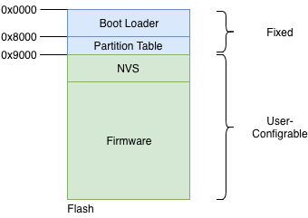

## [Как перераспределить память esp32](https://kotyara12.ru/iot/esp32_flash/?ysclid=mwj1wkmu8942565395)

У модулей ESP нет микросхемы EEPROM. Все данные – и двоичные данные прошивки, и файлы (если есть), и все переменные хранятся исключительно на flash-памяти. При этом весь доступный объем микросхемы flash-памяти разбивается на несколько отдельных разделов, в каждом из которых хранится та или информация.

### [Таблица разделов ESP](#)

Flash-память каждой ESP может хранить загрузчик, одно или несколько приложений, а также множество различных дополнительных данных: данные калибровки, различные параметры, файловые системы и т. д. Это очень похоже на таблицу разделов обычного компьютера – на обычном ПК вы также можете создать несколько разделов (например диск С:\ и диск D:\) на одном  и том же физическом жестком диске.



Для того, чтобы задать необходимую структуру расположения разнородных данных на flash, используется таблица разделов. Именно таблица разделов определяет, что где лежит и когда все это кончится. 

Таблица разделов записывается на ту же самую flash-память по адресу 0x8000 в flash-памяти (то есть сразу после загрузчика). Она занимает 4 КБ, поэтому первый раздел после неё должен начинаться не раньше адреса 0x9000.

#### Важные ограничения таблицы разделов ESP32:

Каждый сектор flash памяти имеет минимальный размер ***4 КБ или 0x1000 байт*** в шестнадцатеричном представлении (здесь и далее все размеры – именно в шестнадцатеричном виде).

Все размеры и смещения должны быть выровнены по этому значению – 0x1000, 0x2000 и т.д. То есть задать размер раздела 0x0100 или 0x0500 у вас не выйдет.

Начальная область Flash-памяти по умолчанию занята под загрузчик. Поэтому прикладные разделы должны располагаться начиная с адреса, заданного в константе CONFIG_PARTITION_TABLE_OFFSET – это так называемое смещение по умолчанию (плюс размер самой таблицы – об этом далее). 

На момент написания статьи это значение равно 0x8000. Однако, в некоторых случаях загрузчик не впихивается в отведенное ему место (например если вы включили отладочные сообщения в лог для загрузчика) и в этом случае вам потребуется увеличить это значение и сдвинуть все последующие разделы.

Длина таблицы разделов составляет 0xC00 байт, то есть допускается максимум 95 записей. Контрольная сумма MD5, используемая для проверки целостности таблицы разделов во время запуска, добавляется сразу же после данных таблицы. Таким образом, таблица разделов занимает ровно один сектор флэш-памяти. В результате любой следующий за ним раздел должен располагаться как минимум по адресу смещение по умолчанию + 0x1000. То есть начало “пользовательской” таблицы разделов сдвигается до 0x9000.

#### Как выглядит файл таблицы разделов

Для начала давайте познакомимся с самим файлом таблицы разделов. Это обычный текстовый файл в формате CSV (значения через запятую, в кодировке UTF-8 без BOM, но это не имеет особого значения, так как в нём допускаются только кошерные символы латиницы, а они в любой кодировке занимают ровно 1 байт).

- Каждая строка определяет один раздел (исключая комментарии, которые начинаются с символа #)

- Для каждого раздела должны быть указаны следующие поля: Name, Type, SubType, Offset, Size и Flags

- Загрузчик указывать не нужно


Например:

```
# ESP-IDF Partition Table
# 4MB FLASH (0x400000): 2 OTA + 2 NVS (sys+app) + 2 cert bundle + coredump
# Name,        Type, SubType,  Offset,   Size,     Flags
otadata,       data, ota,      0x9000,   0x2000, 
nvs,           data, nvs,      0xb000,   0x8000, 
nvs_app,       data, nvs,      0x13000,  0xd000, 
certs_factory, data, 0x40,     0x20000,  0x18000, 
certs_app,     data, 0x41,     0x38000,  0x18000,
ota_0,         app,  ota_0,    0x50000,  0x1d0000, 
ota_1,         app,  ota_1,    0x220000, 0x1d0000, 
coredump,      data, coredump, 0x3f0000, 0x10000, 
```

Каждая строка в таблице разделов имеет имя (метку), тип (приложение, данные или что-то еще), подтип, смещение во флэш-памяти, куда будет загружен этот раздел, и его размер. Опционально можно дополнительные флаги (опции).

#### Name

Имя раздела — оно может содержать до 16 символов. По этому имени загрузчик или ваша программа может обращаться к нему. 

Есть стандартные имена разделов, известные системе сборки заранее: nvs, coredump, которые системные API “знают” заранее. Например wifi драйвер будет искать настройки в системном NVS-разделе, который так и назван – nvs. К загрузочным разделам загрузчик обращается не по имени, а по субтипу. Например загрузчик “знает”, что основное приложение лежит в разделе с типом app и субтипом factory, а название раздела ему, в общем-то, “до лампочки”.

Но для “своих собственных” разделов вы можете задать произвольные имена, главное чтобы они были одинаковы.
 
#### Type и SubType

Тип и подтип раздела — самая важная часть таблицы разметки. Эти поля определяют, какого типа данные хранятся в данном разделе.

Типов всего два – app и data, подтипов у них гораздо больше:

- app, он же ESP_PARTITION_TYPE_APP (цифровое значение 0x00)
Разделы этого типа предназначены для хранения прошивки (application – приложение), таких разделов может быть как минимум один или больше. 

> Важно! Для разделов типа app его размер и посадочное место (смещение) должны быть выровнены до 0x10000 (64 КБ)!

Ну и, конечно же, размер раздела должен быть не меньше размера скомпилировано вами кода с запасом на будущие модификации. Но не слишком увлекайтесь – иначе на другие разделы места не останется. 30%~50% к размеру текущей прошивки “на вырост” будет оптимальным выбором. 

Если таких разделов несколько (например два раздела OTA – желательно, чтобы их размеры совпадали, хотя это не строго обязательно.  

factory (0x00)

Раздел, предназначенный для “заводского” приложения, то есть в состоянии до применения любых OTA-обновлений.

Не обязательный раздел, если вы используете OTA и наоборот – обязательный, если разделов OTA нет. Если он есть, то он должен быть в единственном числе.  

Сюда по умолчанию система сборки ESP-IDF помещает скомпилированный код во время прошивки ESP32 кабелем. Загрузчик запустит это “заводское” приложение, если не обнаружит разделы типа ota, например если процедура OTA завершилась с ошибкой. Если этот раздел отсутствует, прошивка будет записана в свободный OTA-раздел.

ОТА никогда не перезаписывает этот раздел, поэтому вы можете быть уверены, что ваше устройство гарантировано запустится, даже если вы путем сложной комбинации кривых рук ушатали все свои ota-разделы.

ota_0 (0x10) … ota_15 (0x1F)

Слоты для OTA-прошивок. Сюда будет помещен код прошивки, полученный “на лету” через WiFi и OTA. Сюда же упадет код при прошивке “с кабеля” в случае, если раздел factory отсутствует. 

Если вы планируете использовать OTA – то вам нужно как минимум два таких раздела, и у каждого из них должен быть уникальный субтип.

Как работает этот механизм, я упоминал в другой статье. 

test (0x20)

Зарезервированный подтип для тестовых прошивок. Но он также может использоваться в качестве резервного загрузочного раздела, если не будет найден другой допустимый раздел приложения (factory или ota).

Можно настроить загрузчик на чтение специального Strapping pin во время каждой загрузки и загрузку этого раздела, если соответствующее GPIO удерживается на низком уровне, см. загрузка тестовой прошивки.

 

🔹 data, он же ESP_PARTITION_TYPE_DATA (цифровое значение 0x01)
К этому типу относятся любые разделы, в которых хранятся какие-либо данные, не важно какие.

ota (0x00)

Специальный раздел служебных данных для системы OTA , в котором хранится информация о выбранном в данный момент слоте приложения OTA.

Этот раздел обязателен только при наличии двух или более OTA разделов типа app и должен иметь размер ровно 0x2000 байт. Если вы не используете OTA разделы – этот раздел также не нужен!

Дополнительные сведения смотрите в документации OTA. 

phy (0x01)

Данный раздел предназначен для хранения параметров инициализации радиомодема WiFi и BT уровня PHY. Это позволяет настраивать радиооборудование для каждого устройства без внесения изменений в прошивку.

В конфигурации по умолчанию раздел phy не используется вовсе, вместо этого данные инициализации оборудования компилируются в само приложение. Таким образом, в большинстве приложений этот раздел можно удалить из таблицы разделов для экономии места. Особенно если вы не выпускаете свои устройства крупными партиями для разных стран.

nvs (0x02)

Этот раздел предназначен для хранения различных настроек и параметров в формате “ключ” – “значение”, используя API энергонезависимого хранилища данных (NVS). NVS API можно (и нужно!) использовать для записи настроек вашего приложения.

Рекомендуемый размер NVS раздела для пользовательских конфигов – 32 ~ 64 килобайта, но не менее 12 КБ. Больше 64 КБ можно, но не нужно, так как сильно растет расход оперативной памяти RAM (~0.5 КБ для 24КБ, ~1.4 КБ для 64КБ, ~2.8 КБ для 128КБ, ~11 КБ для 512КБ) для хранения индекса ключей – поэтому сильно не увлекайтесь. Но и слишком небольшой размер – тоже не есть карашо.

NVS раздел, в том числе, используется и самой ESP-IDF для хранения данных калибровки радиооборудования для каждого конкретного экземпляра устройства (отличных от данных инициализации PHY) и для хранения параметров WiFi-драйвера, если используется функция инициализации esp_wifi_set_storage (WIFI_STORAGE_FLASH). Для этих целей справочная система рекомендует зарезервировать не менее 24 КБ в NVS-разделе. Поэтому рекомендуется использовать отдельные разделы NVS для системных данных (WiFi и т.д.) и данных вашего приложения, дабы уменьшить накладные расходы RAM (так как расход памяти увеличивается с размером NVS не линейно).

nvs_keys (0x04)

Служебный раздел NVS, который используется для хранения ключей шифрования NVS, но только когда включена функция шифрования NVS. Если шифрование данных не используется, то и этот раздел не нужен.

Размер этого раздела должен быть ровно 0x1000 байт. 

 

coredump (0x03)

Специальный раздел, куда можно поместить дамп памяти и регистры процессора при сбое и перезагрузке процессора из-за паники. После перезагрузки можно считать данные из этого раздела и попытаться расшифровать их, чтобы выяснить причину сбоя на удаленном устройстве.

Core dump — это снимок состояния программного обеспечения, который автоматически сохраняется обработчиком паники (panic handler) при возникновении фатальной ошибки. Core dump позволяет проводить посмертный анализ (post-mortem analysis) состояния системы в момент сбоя. Конкретно он содержит:

Снимки всех задач (tasks) в момент паники — каждый снимок включает TCB (Task Control Block) и стек задачи
Регистры CPU упавшей задачи
Содержимое стеков всех задач
Сводку причины паники
Анализируя эти данные, можно выяснить:

Какая задача вызвала панику
На какой инструкции (строке кода) произошёл сбой
Какой был стек вызовов (call stack)
Значения переменных (если они размещены на стеке, а не в куче или css)
 

0x40–0xFE

Дополнительно вы можете использовать кастомные подтипы для хранения каких-либо специальных данных, например пакета корневых сертификатов TLS. В этом случае можно быстро заменить пакет сертификатов, “не трогая” основную прошивку.


 
 
 
 
 
 
### [Partition Tables](https://docs.espressif.com/projects/esp-idf/en/latest/esp32/api-guides/partition-tables.html)


### [Как указать в platformio для esp32 что должно использоваться 8MB OPI PSRAM](#)

***Для Arduino Framework*** добавьте в секцию вашего окружения в platformio.ini следующие настройки:

```
[env:your_env]
platform = espressif32
board = ваше_название_платы
framework = arduino

board_build.arduino.memory_type = qio_opi
build_flags = -DBOARD_HAS_PSRAM -mfix-esp32-psram-cache-issue
```

- board_build.arduino.memory_type = qio_opi указывает тип памяти (QIO для Flash + OPI для PSRAM)

- build_flags = -DBOARD_HAS_PSRAM -mfix-esp32-psram-cache-issue: первый флаг объявляет наличие PSRAM, второй решает проблему с кэшем. 

***Для ESP-IDF Framework*** вместо флагов Arduino добавьте:

```
build_flags = -DCONFIG_SPIRAM_CACHE_WORKAROUND
```

***Для IDE Arduino*** в инструментах указать свойство: PSRAM: "OPI PSRAM".

#### Важные нюансы

- Проверьте маркировку платы. Убедитесь, что на вашей плате действительно установлен чип OPI PSRAM объёмом 8 МБ. Например, для ESP32-S3-WROOM-1-N8R8 это так. 

- Учитывайте ограничения. Даже при корректной настройке PlatformIO, физически доступны обычно только первые 4 МБ PSRAM. 

- Тестирование. После настройки проверьте вывод компилятора — должно отображаться сообщение «PSRAM enabled». 

- Использование памяти. Для выделения памяти из PSRAM используйте функцию ps_malloc(). 

Вместо ручной настройки platformio.ini можно выбрать в PlatformIO подходящую плату с 8 МБ OPI PSRAM (например, esp32-s3-wroom-1-n8r8). Это часто проще и надёжнее. 

#### [Espressif 32](https://docs.platformio.org/en/stable/platforms/espressif32.html)

#### [Работа с внешней памятью PSRAM (SPI RAM) на ESP32](https://kotyara12.ru/iot/esp32-psram/)

#### [ESP32-S3 в Arduino IDE: как настроить плату и загрузить скетч](https://www.clex.kz/solutions/esp32-s3-v-arduino-ide-kak-nastroit-platu-i-zagruzit-sketch)


### Библиография

#### [Таблицы разделов FLASH-памяти для ESP32](https://kotyara12.ru/iot/esp32_flash/?ysclid=mwj1wkmu8942565395) 

#### [Partitions API](https://docs.espressif.com/projects/esp-idf/en/stable/esp32/api-reference/storage/partition.html)

#### [Storage API](https://docs.espressif.com/projects/esp-idf/en/stable/esp32/api-reference/storage/index.html#storage-api)


