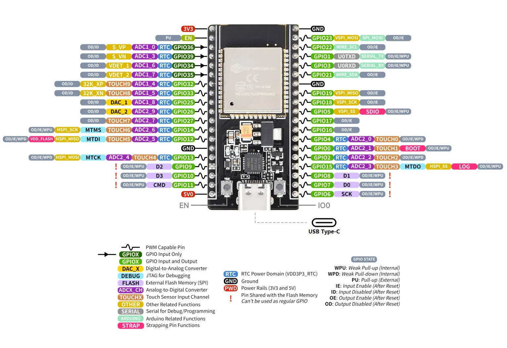

## [95-NodeMCU-32S](https://vibe-boards.mooo.com/boards/nodemcu-32s/)



Штатное распределение памяти:

```

rst:0x1 (POWERON_RESET),boot:0x13 (SPI_FAST_FLASH_BOOT)
configsip: 0, SPIWP:0xee
clk_drv:0x00,q_drv:0x00,d_drv:0x00,cs0_drv:0x00,hd_drv:0x00,wp_drv:0x00
mode:DIO, clock div:1
load:0x3fff0030,len:4640
load:0x40078000,len:15620
ho 0 tail 12 room 4
load:0x40080400,len:3164
entry 0x4008059c
[     4][D][esp32-hal-cpu.c:317] setCpuFrequencyMhz(): PLL: 480 / 2 = 240 Mhz, APB: 80000000 Hz
=========== Before Setup Start ===========
Chip Info:
------------------------------------------
  Model             : ESP32
  Package           : D0WD-Q6
  Revision          : 1.00
  Cores             : 2
  CPU Frequency     : 240 MHz
  XTAL Frequency    : 40 MHz
  Features Bitfield : 0x00000032
  Embedded Flash    : No
  Embedded PSRAM    : No
  2.4GHz WiFi       : Yes
  Classic BT        : Yes
  BT Low Energy     : Yes
  IEEE 802.15.4     : No
------------------------------------------
INTERNAL Memory Info:
------------------------------------------
  Total Size        :   377732 B ( 368.9 KB)
  Free Bytes        :   336952 B ( 329.1 KB)
  Allocated Bytes   :    33584 B (  32.8 KB)
  Minimum Free Bytes:   331180 B ( 323.4 KB)
  Largest Free Block:   110580 B ( 108.0 KB)
------------------------------------------
Flash Info:
------------------------------------------
  Chip Size         :  4194304B (4 MB)
  Block Size        :    65536B (  64.0 KB)
  Sector Size       :     4096B (   4.0 KB)
  Page Size         :      256B (   0.2 KB)
  Bus Speed         : 80 MHz
  Flash Frequency   : 80 MHz (source: 80 MHz, divider: 1)
  Bus Mode          : DIO
------------------------------------------
Partitions Info:
------------------------------------------
                nvs : addr: 0x00009000, size:    20.0 KB, type: DATA, subtype: NVS
            otadata : addr: 0x0000E000, size:     8.0 KB, type: DATA, subtype: OTA
               app0 : addr: 0x00010000, size:  1280.0 KB, type:  APP, subtype: OTA_0
               app1 : addr: 0x00150000, size:  1280.0 KB, type:  APP, subtype: OTA_1
             spiffs : addr: 0x00290000, size:  1408.0 KB, type: DATA, subtype: SPIFFS
           coredump : addr: 0x003F0000, size:    64.0 KB, type: DATA, subtype: COREDUMP
------------------------------------------
Software Info:
------------------------------------------
  Compile Date/Time : Nov 16 2026 20:00:18
  Compile Host OS   : windows
  ESP-IDF Version   : v5.5.4
  Arduino Version   : 3.3.8
------------------------------------------
Board Info:
------------------------------------------
  Arduino Board     : NODEMCU_32S
  Arduino Variant   : nodemcu-32s
  Arduino FQBN      : esp32:esp32:nodemcu-32s:FlashFreq=80,UploadSpeed=115200,DebugLevel=verbose,EraseFlash=all
============ After Setup End =============

Время:              876
Cвободная куча:  334476  от ОЗУ    377732
FreePSRAM:            0  от FLASH  0

```

### Библиография

#### [NodeMCU-32S](https://docs.platformio.org/en/latest/boards/espressif32/nodemcu-32s.html)

#### [NodeMCU-32S для быстрого прототипирования IoT-приложений](https://vibe-boards.mooo.com/boards/nodemcu-32s/)

#### [NodeMCU-32Specification](https://www.e-komponent.com/Data/EditorFiles/Datasheet/AI-THINKER/NodeMCU-32S_v1.3.pdf)

#### [ESP32: чипы, модули, платы...](https://dzen.ru/a/YygOUXbMMSjaAjcq?ysclid=mwjejq10qd711853534)

#### [чем отличается esp32 от esp32-s](https://yandex.ru/search/?text=%D1%87%D0%B5%D0%BC+%D0%BE%D1%82%D0%BB%D0%B8%D1%87%D0%B0%D0%B5%D1%82%D1%81%D1%8F+esp32+%D0%BE%D1%82+esp32-s&clid=2261451&banerid=6301000000%3ASW-694005a33c95&win=513&lr=18)

#### [Модуль микроконтроллера ESP-32S с IPEX разъёмом](https://shop.robotclass.ru/item/1677?adata=ym3&etext=2202.T6nX9HWfitf3ig4ebUVUek_43PptXc5kpUo09awC-31mYWxhZ3R0ZWhpa2hpbG9l.de6c148fb4f8ad237498f90c307fff3236a539f7&yclid=17767640441734299647)

#### [Плата разработчика NodeMCU ESP-32S Development Board TYPE-C USB 38-pin](https://compacttool.ru/plata-razrabotchika-nodemcu-esp-32s-development-board-type-c-usb-38-pin?ysclid=mwjeftd7n6566630272)

