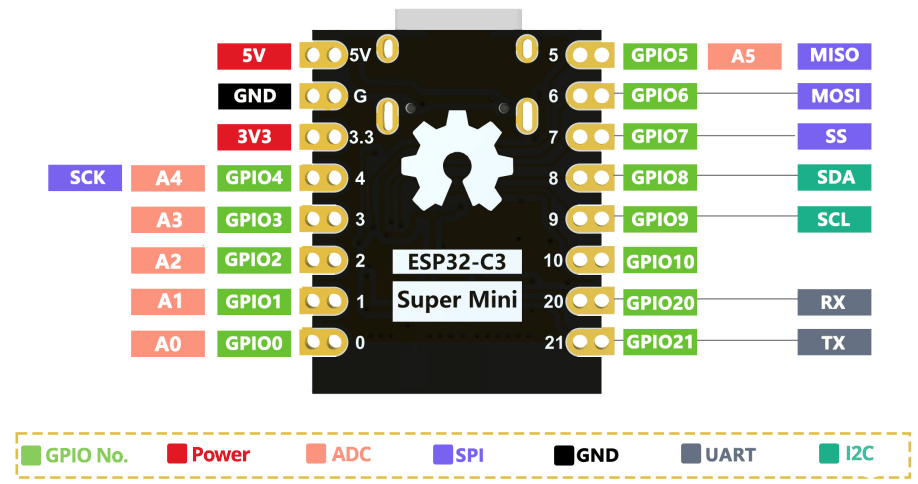

## [ESP32-C3 Super Mini](https://wiki.alashed.kz/esp32/rnt/getting-started-esp32-c3-super-mini/index.html)

```
Chip Info:
------------------------------------------
  Model             : ESP32-C3
  Package           : 0
  Revision          : 0.04
  Cores             : 1
  CPU Frequency     : 160 MHz
  XTAL Frequency    : 4012
  Embedded Flash    : No
  Embedded PSRAM    : No
  2.4GHz WiFi       : Yes
  Classic BT        : No
  BT Low Energy     : Yes
  IEEE 802.15.4     : No
------------------------------------------
INTERNAL Memory Info:
------------------------------------------
  Total Size        :   326764 B ( 319.1 KB)
  Free Bytes        :   291496 B ( 284.7 KB)
  Allocated Bytes   :    31092 B (  30.4 KB)
  Minimum Free Bytes:   286256 B ( 279.5 KB)
  Largest Free Block:   147444 B ( 144.0 KB)
------------------------------------------
Flash Info:
------------------------------------------
  Chip Size         :  4194304B (4 MB)
  Block Size        :    65536B (  64.0 KB)
  Sector Size       :     4096B (   4.0 KB)
  Page Size         :      256B (   0.2 KB)
  Bus Speed         : 80 MHz
  Flash Frequency   : 80 MHz (source: 80 MHz, divider: 1)
  Bus Mode          : QIO
------------------------------------------
Partitions Info:
------------------------------------------
                nvs : addr: 0x00009000, size:    20.0 KB, type: DATA, subtype: NVS
            otadata : addr: 0x0000E000, size:     8.0 KB, type: DATA, subtype: OTA
               app0 : addr: 0x00010000, size:  1280.0 KB, type:  APP, subtype: OTA_0
               app1 : addr: 0x00150000, size:  1280.0 KB, type:  APP, subtype: OTA_1
             spiffs : addr: 0x00290000, size:  1408.0 KB, type: DATA, subtype: SPIFFS
           coredump : addr: 0x003F0000, size:    64.0 KB, type: DATA, subtype: COREDUMP
------------------------------------------
Software Info:
------------------------------------------
  Compile Date/Time : Nov 12 2026 18:27:43
  Compile Host OS   : windows
  ESP-IDF Version   : v5.5.4
  Arduino Version   : 3.3.8
------------------------------------------
Board Info:
------------------------------------------
  Arduino Board     : ESP32C3_DEV
  Arduino Variant   : esp32c3
  Arduino FQBN      : esp32:esp32:esp32c3:JTAGAdapter=bridge,CDCOnBoot=cdc,
  PartitionScheme=default,CPUFreq=160,
  FlashMode=qio,FlashFreq=80,FlashSize=4M,UploadSpeed=921600,
  DebugLevel=verbose,EraseFlash=none,ZigbeeMode=default
============ Before Setup End ============

=========== After Setup Start ============
INTERNAL Memory Info:
------------------------------------------
  Total Size        :   326764 B ( 319.1 KB)
  Free Bytes        :   291408 B ( 284.6 KB)
  Allocated Bytes   :    31148 B (  30.4 KB)
  Minimum Free Bytes:   286256 B ( 279.5 KB)
  Largest Free Block:   147444 B ( 144.0 KB)
------------------------------------------
GPIO Info:
------------------------------------------
  GPIO : BUS_TYPE[bus/unit][chan]
  --------------------------------------  
    18 : USB_DM
    19 : USB_DP
    20 : UART_RX[0]
    21 : UART_TX[0]
============ After Setup End =============
ядро: 0, приоритет: 1, свободная куча 291408 от ОЗУ 326764, FreePSRAM  0 от FLASH 0 

```

ESP32-C3 Super Mini — это компактная отладочная плата на базе чипа Espressif ESP32-C3, входящего в семейство ESP32. Её основные преимущества перед другими платами ESP32 — малый размер и низкое энергопотребление в режиме глубокого сна. 

ESP32-C3 Super Mini — это компактная отладочная плата с чипом ESP32-C3, имеющим встроенный Wi-Fi и Bluetooth. В отличие от других моделей плат ESP32, этот чип — одноядерный. Плата имеет очень маленький форм-фактор и оптимизирована для низкого энергопотребления, потребляя всего около 43 мкА в режиме глубокого сна, согласно даташиту. На плате 16 контактов, из которых 11 программируемых GPIO поддерживают ADC, PWM, UART, I2C и SPI.

На плате есть кнопки RST (сброс) и BOOT. Кнопка BOOT используется для перевода платы в режим загрузчика (bootloader) для загрузки кода, а кнопка RST сбрасывает плату — полезно для перезапуска и выполнения только что загруженного кода.

Плата также оснащена интерфейсом USB-C, который можно использовать для питания платы, загрузки кода или последовательной связи. 

> В качестве альтернативы можно запитать плату от внешнего источника 5В через контакты 5V и GND — но обратите внимание, что порт USB-C не следует использовать одновременно с внешним источником питания.

Как и многие другие модели плат ESP32, она оснащена встроенным светодиодом. Но в данном случае он подключён к ***GPIO 8*** (а не к GPIO 2, как у большинства плат).

#### Технические характеристики ESP32-C3 Super Mini

- Процессор: 32-битный RISC-V CPU с тактовой частотой до 160 МГц

- Протоколы IEEE 802.11b/g/n WiFi и Bluetooth 5 (LE)

- 400 КБ SRAM, 384 КБ ROM и встроенная 4 МБ flash-память

- Компактная SMD-антенна

- 11 GPIO, поддерживающих следующие интерфейсы: 4 контакта ADC, PWM, UART, I2C, SPI

- Встроенный светодиод на GPIO 8, кнопки Reset и Boot

- Сверхнизкое энергопотребление: всего 43 мкА в режиме глубокого сна

- Малый форм-фактор



```

Контакт  Функция
-------  ----------------------------------------------------------------------

3V3      Выход/вход 3.3В (выходное напряжение от встроенного регулятора или вход для внешнего источника питания 3.3В)

5V       Вход/выход 5В (подключён к USB-C 5В или внешнему источнику 5В)

GND      Контакт земли

GPIO 0   GPIO общего назначения, ADC1, PWM

GPIO 1   GPIO общего назначения, ADC1, PWM

GPIO 2   GPIO общего назначения, ADC1, Strapping Pin (режим загрузки) (избегайте для общего использования)

GPIO 3   GPIO общего назначения, PWM

GPIO 4   GPIO общего назначения, PWM, по умолчанию контакт SPI SCK

GPIO 5   GPIO общего назначения, PWM, по умолчанию контакт SPI MISO

GPIO 6   GPIO общего назначения, PWM, по умолчанию контакт SPI MOSI

GPIO 7   GPIO общего назначения, PWM, по умолчанию контакт SPI SS

GPIO 8   Подключён к встроенному светодиоду (активный низкий); Strapping Pin (избегайте для общего использования); по умолчанию контакт I2C SDA

GPIO 9   Подключён к кнопке BOOT (LOW для входа в загрузчик), Strapping Pin (избегайте для общего использования); по умолчанию контакт I2C SCL

GPIO 10  GPIO общего назначения, PWM

GPIO 20  GPIO общего назначения, PWM, по умолчанию контакт UART RX

GPIO 21  GPIO общего назначения, PWM, по умолчанию контакт UART TX

```

#### Strapping-контакты

- GPIO 2: strapping-контакт для входа в режим загрузчика — избегайте для общего использования.

- GPIO 8: подключён к встроенному синему светодиоду (инвертированная логика/активный LOW); также является strapping-контактом;

- GPIO 9: подключён к кнопке BOOT — избегайте для общего использования;

Вы по-прежнему можете использовать strapping-контакты в своих проектах, однако учитывайте колебания состояния этих GPIO при сбросе ESP32 или переходе в режим загрузчика.

#### Контакты питания

Для питания доступны контакты 5V, 3V3 и GND.

Контакт 3V3 обеспечивает напряжение 3.3В от встроенного регулятора или принимает 3.3В от внешнего источника питания. Аналогично, контакт 5V можно использовать как вход для питания платы, или он выдаёт 5В от USB-источника.

#### PWM

Все GPIO общего назначения могут выводить ШИМ-сигналы (PWM).

#### Аналоговые (ADC) контакты

GPIO 0, 1, 2, 3, 4 и 5 поддерживают аналоговое считывание:

```
GPIO 0: ADC1_CH0
GPIO 1: ADC1_CH1
GPIO 2: ADC1_CH2
GPIO 3: ADC1_CH3
GPIO 4: ADC1_CH4
GPIO 5: ADC1_CH5
```

#### UART, I2C и PWM

Благодаря функции мультиплексирования ESP32, интерфейсы UART, SPI и I2C могут быть назначены практически на любой GPIO.

Однако при использовании Arduino IDE и выборе платы ESP32 C3 в меню Boards по умолчанию используются следующие контакты:

```
UART:  по умолчанию GPIO 20 (RX) и GPIO 21 (TX)
SPI:   по умолчанию GPIO 6 (MISO), GPIO 7 (MOSI), GPIO 10 (SCK) и GPIO 5 (SS)
I2C:   по умолчанию GPIO 8 (SDA) и GPIO 9 (SCL)
```

### [Как программно проверить напряжение питания esp32-c3](https://yandex.ru/search/?text=%D0%BA%D0%B0%D0%BA+%D0%BF%D1%80%D0%BE%D0%B3%D1%80%D0%B0%D0%BC%D0%BD%D0%BE+%D0%BF%D1%80%D0%BE%D0%B2%D0%B5%D1%80%D0%B8%D1%82%D1%8C+%D0%BD%D0%B0%D0%BF%D1%80%D1%8F%D0%B6%D0%B5%D0%BD%D0%B8%D0%B5+%D0%BF%D0%B8%D1%82%D0%B0%D0%BD%D0%B8%D1%8F+esp32-c3&clid=2261451&banerid=6301000000%3ASW-694005a33c95&win=513&lr=18)

Программно проверить напряжение питания ESP32-C3 действительно можно — для этого используется встроенный аналого-цифровой преобразователь (АЦП). 

ESP32-C3 сам по себе не имеет отдельного пина для измерения напряжения — для этого на плате обычно собирают делитель напряжения, а сигнал считывают с одного из аналоговых пинов (например, A0). 

- Как это сделать

Соберите делитель напряжения. Подключите измеряемое напряжение через пару резисторов (например, резисторов на 200 кОм) к аналоговому пину (для ESP32-C3 часто используют A0). Это нужно, потому что АЦП внутри чипа работает с напряжением 0–3,3 В, а вы хотите измерять более высокий уровень (например, от аккумулятора или блока питания).

```
Три момента уточнения:

1 - Два одинаковых резистора.
Соедините два резистора последовательно между плюсом источника
питания (VCC/VBAT) и землей (ПТВ).

2 - Подключение к пину.
Точку соединения между резисторами подключите к пину АЦП (лучше использовать каналы ADC1, так как ADC2 конфликтует с модулем WiFi).

3 - Коэффициент деления.
При одинаковых резисторах на пин попадет ровно половина входного напряжения.
```

Напишите код. В среде разработки (Arduino IDE, MicroPython) считывайте значение с пина АЦП. Функция для чтения обычно называется analogRead() (для Arduino) или работает напрямую в MicroPython. Чтобы получить более точный результат и сгладить шумы, рекомендую сделать несколько замеров в цикле и усреднить результат.

Пересчитайте значение в вольты. Зная коэффициент делителя (в нашем случае 1:2, так как резисторы дают отношение 1/2), вы сможете по прочитанному значению АЦП вычислить реальное напряжение. Например, если вы считали 128 (в делении 128/255 ≈ 0,5), значит, реальное напряжение примерно 2 × 128 = 256 (в единицах АЦП). Затем это значение делите на 1000, чтобы перевести из милливольт в вольты.

Выведите результат. Отправьте полученное значение в последовательный порт (Serial), чтобы вы могли его увидеть (например, в мониторе порта Arduino IDE или в терминале MicroPython).
 
- Пример кода (Arduino)

```
void setup() 
{
  Serial.begin(115200);
  pinMode(A0, INPUT); // Указываем, что пин A0 будет входом для АЦП
}

void loop() 
{
  uint32_t sum = 0;
  // Считываем 16 раз и усредняем, чтобы убрать шумы
  for (int i = 0; i < 16; i++) 
  {
    sum += analogRead(A0);
  }
  float voltage = (2.0 * sum / 16) / 1000.0; // Учитываем коэффициент делителя (1/2) и переводим в вольты
  Serial.println(voltage);
  delay(1000); // Обновляем раз в секунду
}
```

- Несколько советов

Учтите калибровочные особенности чипа. У разных экземпляров ESP32-C3 может отличаться опорное напряжение АЦП (full-scale). В некоторых реализациях (например, в библиотеке alogReadMilliVolts()) уже заложена коррекция для конкретного чипа — используйте такую функцию, чтобы получить более точные результаты без ручной калибровки. 

Проверьте схему. Убедитесь, что делитель собран правильно, резисторы номиналы соответствуют вашему диапазону измерений, а контакты подключены к нужным точкам на плате (часто это вывод 3V3 или точка рядом с ним). 

Помните про ограничение по напряжению. Встроенный АЦП рассчитан на работу с сигналами до 3,3 В. Если вы подаёте на плату напряжение выше (например, 5 В через USB), это может привести к повреждению. 

Такой подход удобен, если вам нужно в реальном времени отслеживать напряжение (например, для мониторинга батареи или проверки стабильности источника питания).

- Особенности и повышение точности

• Калибровка. Опорное напряжение АЦП у ESP32 может немного плавать от экземпляра к экземпляру (разброс до ±100 мВ). Измерьте реальное напряжение мультиметром и слегка подкорректируйте dividerRatio (например, 2.03 вместо 2.0).

• Сглаживание шумов. АЦП в ESP32 подвержен помехам. Делайте серию из 10–20 замеров в цикле и берите среднее арифметическое, а также добавьте керамический конденсатор на 0.1 мкФ (100 нФ) параллельно нижнему резистору (между пином АЦП и GND).

• Экономия заряда батареи. Делитель из двух резисторов по 100 кОм будет постоянно потреблять около 18–20 мкА. Для глубокого сна (Deep Sleep) можно использовать резисторы по 1 МОм или коммутировать делитель через MOSFET-транзистор.

• Аппаратный детектор просадки (Brownout Detector). Если вам не нужно знать точное значение в вольтах, а требуется лишь защита от зависания при падении напряжения ниже ~2.43 В, в ESP32 встроен программно настраиваемый Brownout Detector (включается по умолчанию в настройках прошивки).
 

#### [How to check the battery voltage](https://wiki.seeedstudio.com/check_battery_voltage/)

```
void setup() 
{
  Serial.begin(115200);
  pinMode(A0, INPUT);         // ADC
}

void loop() {
  uint32_t Vbatt = 0;
  for(int i = 0; i < 16; i++) 
  {
    Vbatt = Vbatt + analogReadMilliVolts(A0); // ADC with correction   
  }
  float Vbattf = 2 * Vbatt / 16 / 1000.0;     // attenuation ratio 1/2, mV --> V
  Serial.println(Vbattf, 3);
  delay(1000);
}
```

#### [Как проверить ESP32 на работоспособность?](https://gaw.ru/qa/esp32-check/?ysclid=mwehwmah6735877546)

#### [Как определить измерениями мощность блока питания](#)

       Определить реальную максимальную (или отдаваемую) мощность блока питания (БП) с помощью измерений можно путем создания искусственной нагрузки на его выходы и фиксации параметров тока и напряжения.

***Что понадобится для измерений:***

• Электронная нагрузка (или мощные резисторы/реостаты с подходящим рассеиванием тепла) — устройство, позволяющее плавно повышать ток по каждой линии (+12В, +5В, +3.3В).

• Мультиметр (или два-три мультиметра) для точного контроля выходных напряжений.

• Вашметр (ваттметр) в розетку — для измерения потребляемой мощности из сети 220В (чтобы вычислить КПД).

• Токовые клещи или встроенные амперметры.

***Порядок проведения измерений:***

1. Замер напряжения холостого хода:

• Включите БП без нагрузки (замкните зеленый и черный провод на разъеме 24-pin ATX, если блок не подключен к плате).

• Измерьте мультиметром напряжение на линиях +12В, +5В и +3.3В. В норме отклонения не должны превышать ±5%.

2. Поэтапное увеличение нагрузки:

• Подключите электронную нагрузку к основным линиям (основная мощность современного ПК сосредоточена на линии +12В).

• Начните постепенно увеличивать ток (I) по линии +12В и другим линиям, отслеживая напряжение (U).

• По закону Ома и мощности вычислите мощность на каждом канале: P = U × I.

• Суммируйте мощности всех линий.

3. Определение предела (точки защиты или деградации):

• Продолжайте повышать нагрузку, пока напряжение на какой-либо из линий не начнет проседать ниже допустимых стандартом пределов (например, ниже 11.4В для линии 12В) или пока не сработает встроенная защита от перегрузки (OPP / OCP) и блок не отключится.

• Максимальное значение тока, при котором блок держит стабильное напряжение без сильных просадок и перегрева, и есть его реальная рабочая мощность.

4. Расчет КПД (эффективности):

• С помощью ваттметра в розетке посмотрите, сколько энергии блок забирает из сети (\(P_{вх}\)), когда выданная им в нагрузку мощность составляет \(P_{вых}\).
• Формула КПД: \(\eta = (P_{вых} / P_{вх}) \times 100\%\).

Важно: Проведение таких тестов на предельных режимах связано с риском выхода блока питания из строя (если защита не сработает вовремя) или перегрева силовой части (транзисторов, диодных сборкок). В домашних условиях проще и безопаснее ориентироваться на паспортную этикетку БП (производительность по линии +12В) или использовать программный мониторинг под стресс-тестами ПК (хотя софтверные замеры дают лишь косвенную оценку энергопотребления системы).


