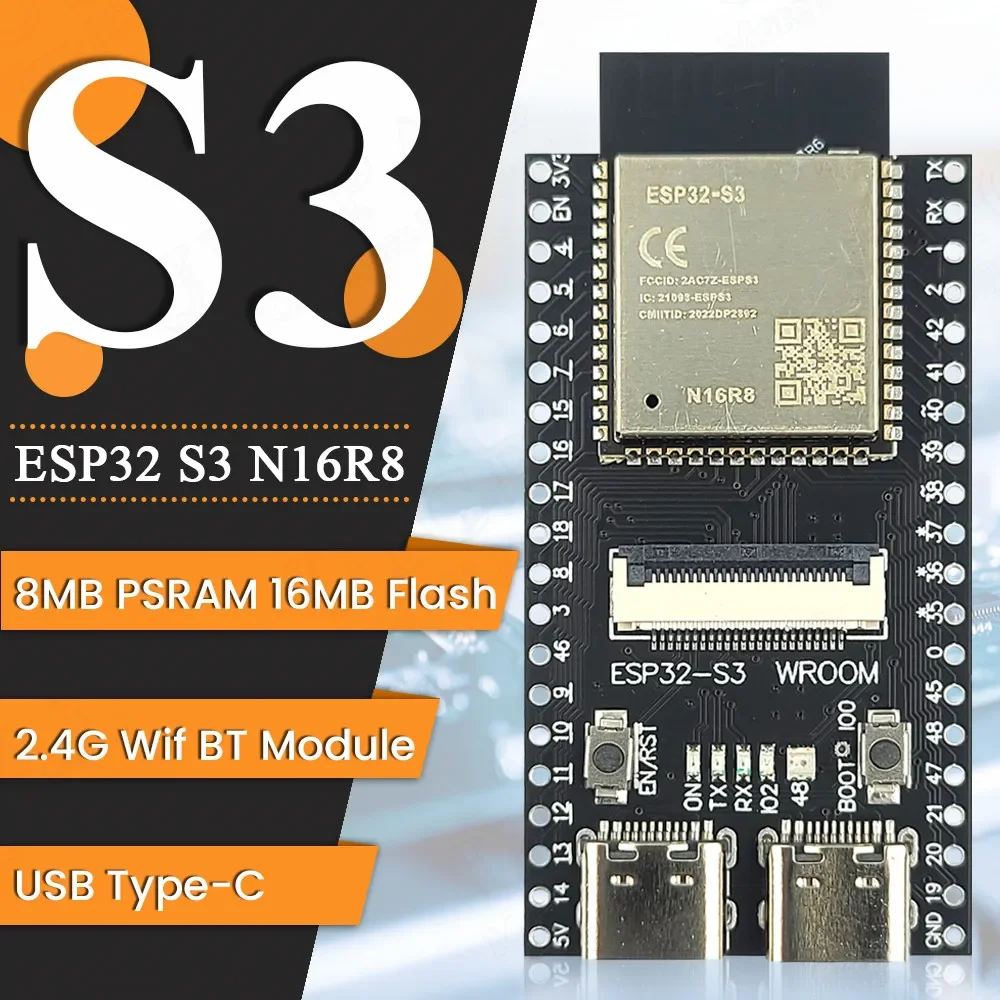
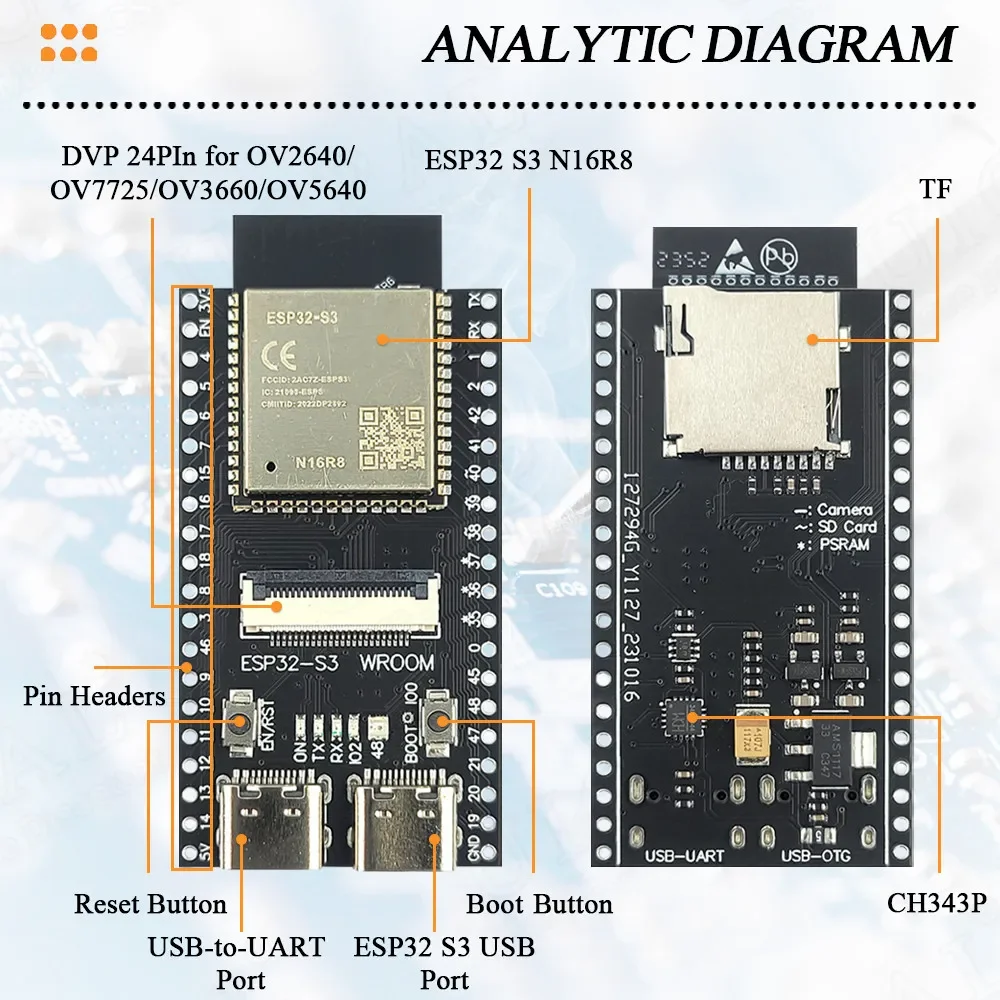
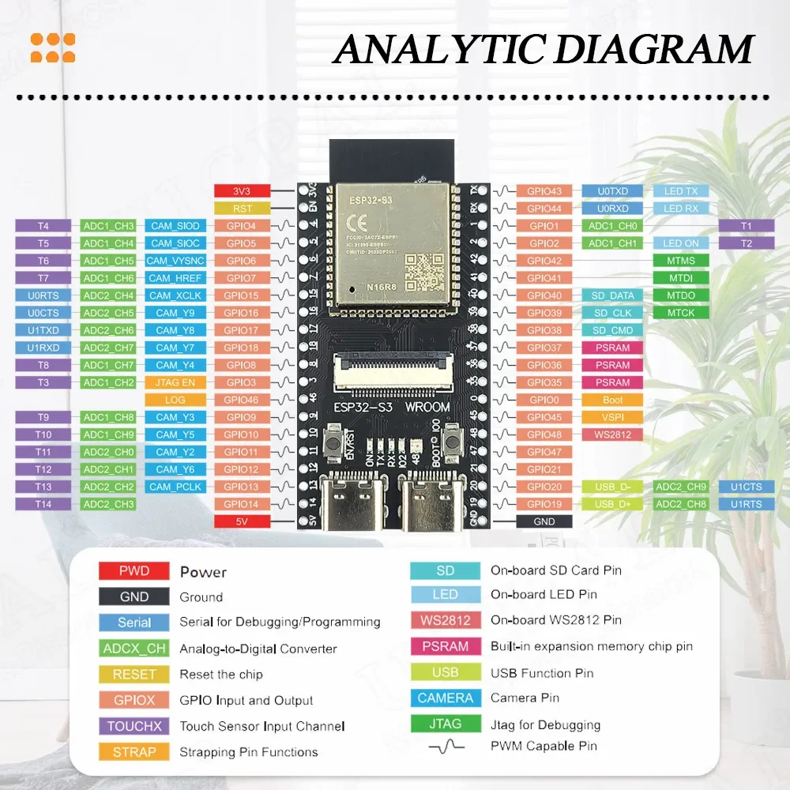
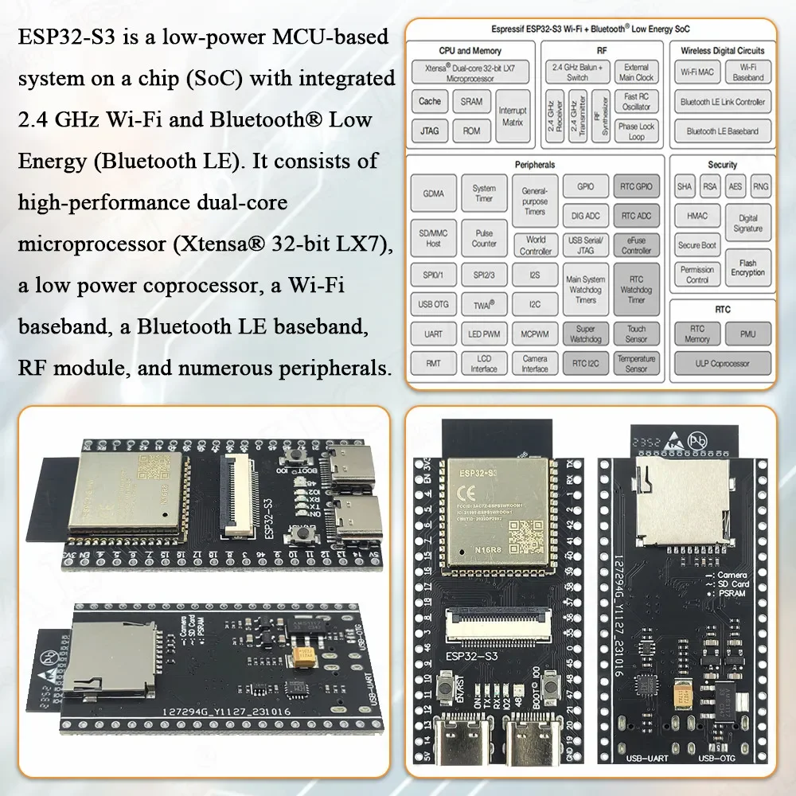
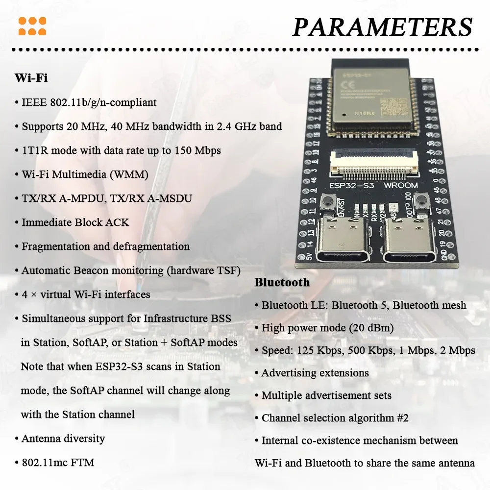
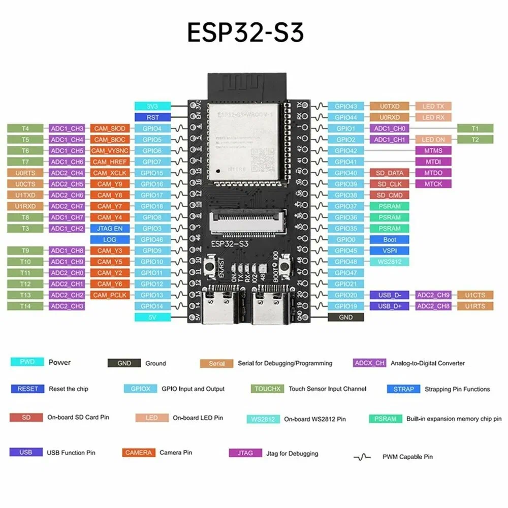

## [ESP32-S3 N16R8](#)

### [Макетная плата ESP32 S3 N16R8, модуль камеры 2,4G Wifi BT для OV2640 OV5640 8 Мб PSRAM 16 Мб, флэш-памяти, комнаты N16R8](https://aliexpress.ru/item/1005006698752647.html?spm=a2g2w.orderdetail.0.0.7d1b4aa6Flu5TQ&sku_id=12000038039164882&_ga=2.170858208.1370450607.1751301098-257156806.1703682747)











Рабочая температура
-20 to +70



### [Управление RGB светодиодом на ESP32-S3](https://dzen.ru/a/ZW7VJcIF-xcr7YuJ)

> 2026-11-08 Выдержки из статьи применительно к моей плате ESP32-S3-N16R8.

На плате расположен адресный RGB светодиод, связанный с пином 48.

### [ESP32-S3 N16R8: распиновка, настройка Arduino IDE и PSRAM](https://trema.ru/esp32-s3/?ysclid=mw7v24fs7c353002720)

#### Характеристики ESP32-S3 N16R8

- Чип	ESP32-S3: два ядра Xtensa LX7 до 240 МГц

- Модуль	ESP32-S3-WROOM-1; у N16R8 — 16 МБ флеш и 8 МБ PSRAM

- Оперативная память	512 КБ в чипе плюс 8 МБ PSRAM у N16R8

- Wi-Fi	802.11 b/g/n, только 2,4 ГГц

- Bluetooth	Bluetooth 5 (LE) и Mesh; классического Bluetooth нет

- Выводы 44 контакта; GPIO у модуля — 36, у N16R8 три из них заняты памятью

- Аналоговые входы 	20 каналов, 12 бит; при Wi-Fi работают только 1–10

- Сенсорные входы	14, выводы 1–14

- ШИМ	8 каналов на любом выводе, плюс 2 блока для моторов (MCPWM)

- Интерфейсы	3 × UART, 2 × I²C, 2 × SPI для своих устройств, 2 × I²S для звука, CAN (TWAI, через внешний трансивер), камера и параллельный экран

- USB	два разъёма: родной USB чипа и мост USB-UART

- ***Логика	3,3 В; на вход — не больше 3,6 В***

- Питание	5 В по разъёмам USB (одному или обоим) или на вывод 5V; 3,0–3,6 В на вывод 3V3. Один способ за раз

- Кнопки	BOOT (вывод 0) и RESET

- Светодиод	цветной адресный: чаще всего на выводе 48 (клон, DevKitC-1 v1.0), у v1.1 — на 38

По скорости S3 обгоняет классическую ESP32: Espressif даёт ей 1330 баллов в тесте CoreMark на двух ядрах против 1080. Но главное у неё другое — PSRAM и родной USB. PSRAM — это дополнительная оперативная память: у N16R8 её 8 МБ при 512 КБ обычной. Она нужна там, где обычной памяти не хватает: кадры камеры, буфер экрана, звук, большие массивы. Родной USB позволяет плате самой стать клавиатурой или мышью.

> ***Логика у платы 3,3-вольтовая. По паспорту чипа на вход нельзя подавать больше 3,6 В, поэтому сигнал от пятивольтовой Arduino или датчика подключают через делитель из двух резисторов или преобразователь уровней.***

#### Документация Espressif, если нужны подробности:

- [Паспорт чипа ESP32-S3 (PDF, на английском)](esp32-s3_datasheet_en.pdf)

- [Паспорт модуля ESP32-S3-WROOM-1 со всеми вариантами маркировки (PDF)](esp32-s3-wroom-1_wroom-1u_datasheet_en.pdf)

- [Руководство по плате ESP32-S3-DevKitC-1 v1.1](https://docs.espressif.com/projects/esp-dev-kits/en/latest/esp32s3/esp32-s3-devkitc-1/user_guide_v1.1.html)

- [Принципиальная схема DevKitC-1 v1.1 (PDF)](SCH_ESP32-S3-DevKitC-1_V1.1_20221130.pdf)


#### Что значит N16R8, N8R8 и N8R2

Маркировка напечатана на металлическом экране модуля, например «ESP32-S3-WROOM-1 N16R8». Буква N и число — флеш-память в мегабайтах, R и число — PSRAM. 

Octal значит, что PSRAM подключена по восьми линиям, в меню это пункт «OPI PSRAM». Quad — по четырём, в меню «QSPI PSRAM». 

От маркировки зависит, что выставлять, поэтому прочитайте её до первой прошивки, а при покупке ищите её в названии товара и на фото экрана модуля:

```
Маркировка	 Флеш	               PSRAM	    Что выбрать в пункте PSRAM
---------------------------------------------------------------------------
N16R8	     16 МБ	               8 МБ, Octal	«OPI PSRAM»; выводы 35–37 заняты
N8R8, N4R8	 8 или 4 МБ            8 МБ, Octal	«OPI PSRAM»; выводы 35–37 заняты
N16R2, N8R2, N4R2  16, 8 или 4 МБ  2 МБ, Quad	«QSPI PSRAM»; выводы 35–37 свободны
N16, N8, N4, H4	16, 8 или 4 МБ	   нет	        «Disabled»; 35–37 свободны, вывод 45 при включении не подключайте к плюсу. H4 рассчитан на жару до 105 °C
N16R16VA	 16 МБ	               16 МБ, Octal	«OPI PSRAM»; 35–37 заняты, память на 1,8 В, и выводы 47 и 48 тоже на 1,8 В
```

Не путайте N16R8 с N16R8V, N32R8V и N32R16V: буква V на конце значит модуль ESP32-S3-WROOM-2. У него и флеш-память восьмилинейная, и память работает от 1,8 В, а в меню для него свой пункт — «ESP32S3 Dev Module Octal (WROOM2)». Его ставят, например, на официальную DevKitC-1 N32R16V. Выводы 47 и 48 у таких модулей тоже работают на 1,8 В: датчики на 3,3 В к ним напрямую не подключайте.

У модулей с восьмилинейной PSRAM есть ещё одно ограничение из паспорта: рабочая температура до 65 °C, а не до 85, как у большинства других модулей. Для комнаты это неважно, для корпуса на солнце — важно.

#### Какие выводы можно занимать:

```
Выводы	      Статус, почему
------------- -----------------------------------------------------------------
1–10	      Свободно, лучшие выводы: цифровые, ШИМ, сенсорные и аналоговые, которые работают и при Wi-Fi
11–18	      Свободно, цифровые и ШИМ, 11–14 ещё и сенсорные. Аналоговые, но только пока Wi-Fi выключен. 11–13 — SPI по умолчанию
21, 39–42, 47 Свободно, обычные выводы. 39–42 — ещё и выводы для отладчика (JTAG), без него они обычные. У модулей с буквой V (N16R16VA, WROOM-2) вывод 47 работает на 1,8 В
38 или 48	  Свободно, кроме одного.	На одном из них цветной светодиод: чаще всего на 48 (клон и v1.0), у v1.1 — на 38
0, 3, 45, 46  С осторожностью	Пины запуска: при включении к ним не должно быть подключено ничего, что держит их в 0 или в 1, — кнопка, датчик с резистором. 0 — кнопка BOOT
43, 44	      Лучше не занимать	UART0 и мост разъёма COM: займёте — пропадёт монитор порта через этот разъём
19, 20	      Лучше не занимать	Линии родного USB: займёте — пропадёт порт на разъёме USB
35, 36, 37	  Нельзя на модулях R8	Соединены с PSRAM внутри модуля, хоть и выведены на гребёнку: у N16R8, N8R8, N4R8, N16R16VA и у модулей WROOM-2
22–34         Их нет на гребёнке. 22–25 у чипа нет вовсе, 26–32 заняты флеш-памятью и PSRAM внутри модуля, 33 и 34 модуль наружу не выводит
```

> Чаще всего обжигаются на выводах 35, 36 и 37. Они есть на гребёнке, на многих картинках из интернета их рисуют свободными и даже советуют под SPI. Но у модулей с восьмилинейной PSRAM (N16R8, N8R8, N4R8) эти три линии внутри модуля соединены с PSRAM. Подключите к ним что-нибудь — и плата начнёт сбоить или перестанет запускаться.

> Пины запуска важны только в момент включения и сброса. 0 — кнопка BOOT: если что-то держит его в нуле, плата уходит в режим прошивки. 46 при включении не подключайте к плюсу: вместе с 0 он выбирает режим запуска. 45 опасен только для модулей без PSRAM: если при включении он подключён к плюсу, флеш-память получает 1,8 В вместо 3,3, и модуль не запускается. У N16R8 это напряжение задано при производстве, и 45 на него не влияет.

#### Шины по умолчанию:

I²C — SDA на выводе 8, SCL на выводе 9. У S3 две шины I²C, и обе можно перенести на любые свободные выводы командой Wire.begin(sda, scl). Подробнее — в статье про I²C.

SPI — SS 10, MOSI 11, SCK 12, MISO 13: для карт памяти и дисплеев. Не путайте с выводами 35–37 из чужих схем.

UART — у S3 три аппаратных порта. UART0 на выводах 43 и 44 занят мостом разъёма COM, а Serial1 и Serial2 можно вывести на любые свободные выводы: Serial1.begin(9600, SERIAL_8N1, 17, 18); — приём на 17, передача на 18. Подробнее — про UART.

Аналоговые и сенсорные входы — аналоговые 1–10 работают всегда, 11–20 — только пока выключен Wi-Fi. Сенсорные — выводы 1–14. Подробности и скетч — ниже.

#### Зачем ESP32-S3 два USB и к какому подключать кабель

Простое правило: начинайте с разъёма COM и параметра USB CDC On Boot по умолчанию (Disabled) — так монитор порта работает сразу. Родной разъём USB пригодится для клавиатуры и мыши, а на платах, где разъём только один, иначе и не получится.

Разъём COM (на некоторых платах UART) ведёт к мосту USB-UART. Это микросхема-переходник, которая превращает USB в обычный последовательный порт, как CH340 на Arduino Nano. На клоне это обычно CH343P — название напечатано на микросхеме рядом с разъёмом, на плате Espressif — CP2102N. Мост соединён с портом UART0, как у классической ESP32; у S3 это выводы 43 и 44. 

Второй разъём подписан USB или OTG. Это родной USB самого чипа на выводах 19 и 20. Через него тоже можно прошивать, плата может притвориться клавиатурой или мышью и даже сама подключать USB-устройства. Только питание им плата Espressif не выдаёт, а клон — лишь с запаянной перемычкой USB-OTG (подробнее — в разделе про питание).

Прошить плату можно через любой разъём. Но монитор порта заработает, только если параметр USB CDC On Boot совпадает с разъёмом. Этот параметр решает, куда пойдёт Serial: Disabled — в разъём COM, Enabled — в разъём USB. 

#### Драйвер. 

Родной USB Windows 10 и 11 узнают сами: это стандартный последовательный порт. Мост CH343P они обычно тоже узнают сами. Если порт разъёма COM так и не появился в Диспетчере устройств, поставьте драйвер CH343 с сайта производителя WCH. 

На плате Espressif мост CP2102N: если его порт не появился, поставьте драйвер CP210x с сайта Silicon Labs. Если подключены оба кабеля, порты различают по свойствам: у родного USB в «ИД оборудования» есть VID_303A, у CH343P — VID_1A86. 

Жёлтый значок у «USB JTAG/serial debug unit» — это интерфейс отладки, для загрузки и монитора порта он не нужен. Если не появился ни один порт, скорее всего, кабель только заряжает и не передаёт данные. Как это проверить — [в статье про драйверы и кабели](https://trema.ru/drivers/).

#### ESP32S3 Dev Module: что выставить в Arduino IDE

Пункт меню для этой платы — «***ESP32S3 Dev Module***». Пакет ESP32 ставится один раз через менеджер плат — как это сделать, рассказано в инструкции по установке. Если Arduino IDE не скачивает список пакетов, поможет статья про ошибку 403.

```
ESP32-S3-WROOM-1-N16R8: 16 МБ флеш, 8 МБ Octal PSRAM
----------------------------------------------------
Плата                  ESP32S3 Dev Module (не «Octal (WROOM2)»)
Flash Mode             QIO 80MHz — как по умолчанию, не OPI
Flash Size             16MB (128Mb)
PSRAM                  OPI PSRAM
Partition Scheme       16M Flash (3MB APP/9.9MB FATFS)
USB CDC On Boot        по разъёму: Disabled для COM, Enabled для USB
Важно                  выводы 35, 36 и 37 заняты памятью. 
Рабочая температура    до 65 °C
```

#### Две ловушки со словом OPI. 

У модулей WROOM-1 OPI выбирают только в пункте PSRAM. Пункт Flash Mode оставьте «QIO 80MHz»: флеш у них подключена по четырём линиям, а не по восьми. И не выбирайте плату «ESP32S3 Dev Module Octal (WROOM2)» — она для модулей WROOM-2. 

Если выбрать в Flash Mode «OPI 80MHz», а PSRAM оставить выключенной или QSPI, пакет 3.3.12 даже не соберёт программу. То же будет с платой «Octal (WROOM2)» при выключенной PSRAM:

```
cdefs.h:7:10: fatal error: sdkconfig.h: No such file or directory
     7 | #include "sdkconfig.h"
```
Такая ошибка выглядит как поломка среды, хотя дело в одном пункте меню: для этого сочетания в пакете просто нет нужных файлов. Верните Flash Mode «QIO 80MHz» и плату «ESP32S3 Dev Module».

#### PSRAM: как включить и проверить 8 МБ

Обычные переменные программа держит во внутренней памяти на 512 КБ, а большие буферы может брать из PSRAM. Пакет ESP32 сам отправляет туда большие запросы памяти, а функция ps_malloc() просит память именно оттуда. 

По умолчанию PSRAM выключена: выберите в пункте PSRAM тип по маркировке модуля. Проверить, что всё выставлено правильно, проще всего этим скетчем:

```
// Сколько памяти у платы на самом деле. Флеш-память программа узнаёт
// у самой микросхемы, PSRAM — у ядра, поэтому скетч сразу показывает,
// правильно ли выставлены параметры платы PSRAM и Flash Size.
void setup() 
{
  Serial.begin(115200);
  delay(1500);                                   // время открыть монитор порта

  Serial.print("Чип: ");
  Serial.println(ESP.getChipModel());
  Serial.print("Флеш-память, байт: ");
  Serial.println(ESP.getFlashChipSize());        // настоящий объём микросхемы
  // psramFound() тут не годится: при «OPI PSRAM» он отвечает «да» даже
  // без памяти. Надёжнее смотреть на размер.
  Serial.print("PSRAM, байт: ");
  Serial.println(ESP.getPsramSize());            // 0 — PSRAM выключена или не та
  Serial.print("Свободно во внутренней памяти, байт: ");
  Serial.println(ESP.getFreeHeap());

  // Просим миллион байт именно из PSRAM
  uint8_t* buffer = (uint8_t*)ps_malloc(1000000);
  if (buffer) {
    Serial.println("Миллион байт в PSRAM выделен");
    free(buffer);
  } else {
    Serial.println("Не вышло: PSRAM нет или она выключена в параметрах платы");
  }
}

void loop() 
{
}
```

На N16R8 с пунктом «OPI PSRAM» скетч покажет флеш-память 16 777 216 байт и PSRAM чуть меньше 8 388 608 байт: немного забирает сама система. Объём флеш-памяти скетч узнаёт у самой микросхемы, поэтому покажет настоящие 16 МБ, даже если в меню осталось 4. Так заодно видно, что за модуль вам продали.

Если в маркировке модуля есть R, ноль в строке PSRAM значит, что в меню выбран не тот пункт. С пунктом «Disabled» — как по умолчанию — PSRAM не включается вовсе, а ps_malloc() ничего не выделит. Если выбрать «OPI PSRAM» на модуле с другой памятью или без неё, плата запустится, но память не найдёт, а в мониторе порта при запуске появятся строки PSRAM chip is not connected, or wrong PSRAM line mode и Failed to init external RAM; continuing without it. В чужих примерах наличие памяти часто проверяют функцией psramFound(), но при «OPI PSRAM» она отвечает «да» даже без памяти. Надёжнее смотреть на размер, как в скетче выше.

Отдельно стоит знать про число, которое печатает сборка: «Максимум: 327680 байт» оперативной памяти. Это постоянное число из описания платы, PSRAM в нём не учитывается — её размер виден только на работающей плате.

#### Аналоговые и сенсорные входы

Аналоговых входов двадцать: выводы 1–10 подключены к первому преобразователю, 11–20 — ко второму. Второй преобразователь делит доступ с Wi-Fi, и паспорт прямо говорит, что вместе с Wi-Fi он не работает. 

В пакете ESP32 analogRead() об этом не сообщает: если Wi-Fi перебил измерение, функция вернёт 65535 — число за пределами обычных 0–4095, а analogReadMilliVolts() вернёт 0. Поэтому ***для датчиков в проектах с Wi-Fi берите выводы 1–10.***

Ещё одно отличие от Uno — диапазон. ***analogRead() возвращает число от 0 до 4095***, но измерять напряжение чип умеет примерно до 2,9 В, с погрешностью около 50 мВ после калибровки. Выше показания уже неточные. Функция analogReadMilliVolts() сразу пересчитывает показания в милливольты по заводской калибровке чипа.

Сенсорных входов четырнадцать, на выводах 1–14. Здесь S3 ведёт себя наоборот по сравнению с классической ESP32: при касании число не падает, а растёт. Примеры, написанные под старую плату, сравнивают с порогом «меньше чем» и на S3 не срабатывают. Посмотреть, как меняется число, можно простым скетчем:

```
// Сенсорный вход: вставьте провод в вывод 1 и коснитесь его пальцем.
// У ESP32-S3 число при касании растёт, у классической ESP32 — падает.
void setup() 
{
  Serial.begin(115200);
}

void loop() 
{
  Serial.println(touchRead(T1));   // T1 — это вывод 1
  delay(200);
}
```
#### Если загрузка не идёт: «Failed to connect to ESP32-S3»

Через разъём COM среда сама переводит плату в режим прошивки: мост нажимает за вас RESET и BOOT, и загруженная раньше программа этому не помешает. Через родной USB режим прошивки включает сам чип, и тут старая программа может помешать. Если она уводит плату в сон, падает сразу после старта или заняла выводы 19 и 20, связаться с чипом не получится: порт на разъёме USB пропадёт из списка или не откроется, а если откроется — в журнале будет:

```
A fatal error occurred: Failed to connect to ESP32-S3: No serial data received.
```

Проще всего переключить кабель в разъём COM. Если его на плате нет, войдите в режим прошивки вручную: зажмите BOOT, нажмите и отпустите RESET, отпустите BOOT и нажмите «Загрузить». Номер порта после такого входа может смениться — выберите порт в списке заново. После загрузки нажмите RESET, если программа не запустилась сама.

Монитор порта после загрузки показывает waiting for download — плата осталась в режиме прошивки. Нажмите RESET.

Загрузка обрывается на середине с ошибкой Invalid head of packet — уменьшите Upload Speed в параметрах платы до 115200 и попробуйте другой кабель.

В меню стоит обычная ESP32 — загрузчик скажет прямо: This chip is ESP32-S3, not ESP32. Wrong chip argument?

Остальные причины общие для всех ESP32 — [«ESP32 не прошивается»](https://trema.ru/wiki/errors/esp32-issues/).

#### Монитор порта молчит

Параметр не совпадает с разъёмом. Кабель в разъёме USB, а USB CDC On Boot выключен — или наоборот. Схема с переключателями выше показывает все четыре сочетания.

Текст ушёл раньше, чем открылся монитор. Через родной USB строки, напечатанные в первые мгновения после перезапуска, могут не дойти: компьютер ещё подключает порт. Добавьте в начало setup() задержку на полторы-две секунды.

Плата уснула или перезапускается. В глубоком сне родной USB отключается, и порт пропадает. Перезапуски по кругу разобраны в следующем разделе.

Скорость в мониторе важна только для разъёма COM: там она должна совпадать с числом в Serial.begin(). Для родного USB число скорости ни на что не влияет. Как открыть монитор порта и что делать с непонятными символами вместо текста — в [статье про монитор порта](https://trema.ru/serial-monitor/).

#### Плата перезагружается по кругу

Если в мониторе порта одно и то же сообщение о запуске повторяется снова и снова, найдите в нём строку с ошибкой. Монитор откройте через разъём COM на скорости 115200: на ней пишет сама система при старте, ещё до вашей программы.

- ***Detected size(8192k) smaller than the size in the binary image header(16384k). Probe failed***.	 В пункте Flash Size выбрано больше памяти, чем стоит на модуле. Первое число — настоящий объём, второе — объём из меню	Выставьте Flash Size по маркировке: N8 — «8MB», N16 — «16MB»

- ***Brownout detector was triggered***	 Проседает питание, чаще всего в момент включения Wi-Fi	Возьмите кабель покороче и другой порт USB, а моторы, ленты и сервоприводы питайте отдельно

- ***Guru Meditation Error***	Падает сама программа: например, пишет в память, которую не удалось выделить. Проверьте, что ps_malloc() вернул не пустой указатель и что к выводам 35–37 ничего не подключено. Числа в первой строке зависят от вашей платы: в примере модуль на 8 МБ, а в меню выбрано 16. Ровно так бывает, если выставить настройки N16R8 на плату N8R8.

#### Питание: USB, вывод 5V и перемычки клона

Здесь официальная плата и клон устроены по-разному, и это главная ловушка клонов. 

Выберите плату:

- ***DevKitC-1 Espressif***. 

Вывод 5V, выход: чуть меньше 5 В — немного теряется на диоде. Разъём USB (родной) - питание на разъём USB не выдаёт.

Как устроено - каждый разъём USB подключён к шине 5V через свой диод, к той же шине подключены вывод 5V и стабилизатор на 800 мА.

С вывода 5V можно брать питание для модулей. Espressif называет три способа питания — USB, вывод 5V и вывод 3V3 — взаимоисключающими: выбирайте один.

Вывод 5V работает в обе стороны.

- ***Клон: перемычки не запаяны***.

Вывод 5V - только вход: 5 В от USB на нём нет. Разъём USB (родной) питание на разъём USB не выдаёт.

Как устроено - между выводом 5V и шиной стоит диод, развёрнутый к шине. Подать на вывод 5 В от блока можно, а взять с него питание для модулей — нет: пользователи меряют там от 0,65 до 2,8 вольта вместо пяти. Так клоны чаще всего и продаются.

Модули от вывода 5V питать нельзя.

- ***Клон: запаяна IN-OUT***.

Вывод 5V - выход: чуть меньше 5 В — немного теряется на диоде. Разъём USB (родной) - питание на разъём USB не выдаёт.

Как устроено - перемычка IN-OUT замыкает диод, и вывод 5V соединяется с
шиной: теперь он выдаёт питание, как у платы Espressif. Обратно в компьютер ток по-прежнему не пройдёт — разъёмы отделены от шины своими диодами.

Вывод 5V стал выходом.

- ***Клон: запаяна USB-OTG***.

Вывод 5V - только вход, если IN-OUT не запаяна. Разъём USB (родной) выдаёт чуть меньше 5 В: можно питать мышь или флешку.

Как устроено - перемычка USB-OTG замыкает диод родного разъёма, и шина 5V
соединяется с ним напрямую. Это нужно, чтобы плата питала USB-устройство в режиме хоста. Опасно это, когда у платы есть второй источник — кабель в разъёме COM или блок на выводе 5V: если такую плату подключить родным разъёмом к
компьютеру, этот источник окажется соединён прямо с портом компьютера.

Только для режима хоста, не для подключения к компьютеру.

Так устроены DevKitC-1 v1.1 и клон YD-ESP32-S3 V1.4. У других клонов разводка может отличаться — перемычки ищите рядом с надписями IN-OUT и USB-OTG на плате.

На DevKitC-1 и клоне YD-ESP32-S3 два кабеля сразу, в COM и в USB, подключать можно: каждый разъём отделён от шины питания своим диодом, и для платы это один способ питания. Исключение — клон с запаянной перемычкой USB-OTG.

Бюджет тока такой - модуль на пике передачи Wi-Fi берёт до 355 мА, а порт USB 2.0 компьютера обязан выдать всего 500 мА на всю плату — чаще всего ограничивает именно он. Стабилизаторы на платах линейные: у Espressif он рассчитан на 800 мА, у клона — на 1 А по паспорту, но из 5 В в 3,3 В оба сильно греются. У клона предел по нагреву — около 0,5–0,6 А на всё вместе, включая сам модуль, а у дешёвых копий стабилизатор бывает и слабее. 

> Поэтому с вывода 3V3 берите не больше 100–150 мА: на датчики и небольшой дисплей этого хватает. 

Сервопривод, светодиодную ленту или мотор от 3V3 не питайте: им нужен свой источник, общий с платой только по земле. Подробнее — в [статье про питание](https://trema.ru/pitanie-arduino/).

#### Место под программу: 16 МБ, из которых видно 1,25

С настройками по умолчанию программе отведено 1,25 МБ, сколько бы флеш-памяти ни стояло на модуле. Wi-Fi и Bluetooth занимают много, и на S3 это видно так:

С настройками по умолчанию среда считает флеш-память за 4 МБ, 12 МБ простаивают, а программе отдано всего 1,25 МБ.

Выставьте Flash Size «16MB» и Partition Scheme «16M Flash (3MB APP/9.9MB FATFS)» — под программу станет 3 МБ, а почти 10 МБ уйдут под файлы. Важен именно этот пункт разметки: один только Flash Size места программе не прибавит. 

А если программа всё-таки не влезет, сборка остановится с сообщением «Скетч слишком большой» — это и есть сигнал сменить разметку. И не выбирайте Flash Size больше настоящего объёма: если выставить 16 МБ на модуле с 8 МБ, плата уйдёт в перезагрузку по кругу.

#### Родной USB: плата становится клавиатурой

Этого не умеют Uno R3, классическая ESP32 и C3: S3 через разъём USB может притвориться клавиатурой, мышью или геймпадом. Для этого в параметрах платы нужно выбрать USB Mode: USB-OTG (TinyUSB). Скетч ниже печатает фразу на компьютере по нажатию кнопки BOOT:

```
// Плата притворяется USB-клавиатурой: нажали BOOT — она «напечатала» фразу.
// Работает только через разъём USB (родной). Первые строки проверяют
// настройки: если что-то не так, сборка остановится и подскажет, что поменять.
#if !SOC_USB_OTG_SUPPORTED
#error "Нужна плата с USB-OTG, например ESP32-S3: у ESP32 и ESP32-C3 его нет"
#elif ARDUINO_USB_MODE
#error "В параметрах платы выберите USB Mode: USB-OTG (TinyUSB)"
#endif

#include "USB.h"
#include "USBHIDKeyboard.h"

USBHIDKeyboard Keyboard;
const int BUTTON_PIN = 0;          // кнопка BOOT на плате — это вывод 0

void setup() 
{
  pinMode(BUTTON_PIN, INPUT_PULLUP);
  Keyboard.begin();
  USB.begin();                     // включаем родной USB как клавиатуру
}

void loop() 
{
  if (digitalRead(BUTTON_PIN) == LOW) 
  {   // кнопка нажата
    Keyboard.println("Hello from ESP32-S3");
    delay(500);                    // чтобы одно нажатие не печатало много раз
  }
}
```

Первые строки скетча проверяют настройки. Если USB Mode выбран не тот или у платы нет USB-OTG, сборка остановится и подскажет, что поменять. Это защита от главной ловушки: официальный пример клавиатуры из пакета при настройках по умолчанию собирается в пустую программу — на 100 КБ меньше настоящей, без единой ошибки, только с предупреждением, которое Arduino IDE по умолчанию не показывает. Плата прошивается, а клавиатуры нет.

Ещё две детали. Клавиатура передаёт компьютеру коды клавиш, а не буквы: при включённой русской раскладке вместо «Hello» появится «Руддщ». И монитор порта: если USB CDC On Boot выключен, порт на разъёме USB пропадает, пока плата работает клавиатурой. Тогда монитор смотрят через разъём COM вторым кабелем — подключать плату обоими разъёмами одновременно можно. Если включить USB CDC On Boot, плата на том же разъёме станет и клавиатурой, и портом: так подключают платы с одним разъёмом.

Следующую программу удобнее всего загружать через разъём COM. Если разъёма COM на плате нет, а порт на разъёме USB пропал, выручит ручной вход в режим прошивки кнопками BOOT и RESET.

#### Чего у ESP32-S3 нет

Часть примеров для классической ESP32 на S3 не соберётся. Сборка под «ESP32S3 Dev Module» отвечает так:

- Классический Bluetooth, BluetoothSerial.h:

***'BluetoothSerial' does not name a type***	 - у S3 только Bluetooth LE. Телефонные «терминалы» для модуля HC-05 с ней не работают.

- Аналоговый выход, dacWrite():

***'dacWrite' was not declared in this scope***	- ЦАП у S3 нет, хотя в некоторых карточках он указан. Плавное напряжение получают ШИМом через резистор и конденсатор.

- Датчик Холла, hallRead():
***'hallRead' was not declared in this scope***	- убран из пакета ESP32 версии 3 для всех чипов, у S3 его не было и в железе.

Bluetooth LE у S3 есть: с телефоном плата свяжется через встроенную библиотеку BLE. Чем LE отличается от классического Bluetooth модулей HC-05 — в [статье про Bluetooth](https://trema.ru/bluetooth-arduino/).

Чему не верить в карточках товаров
Wi-Fi 5 ГГц — у S3 только 2,4 ГГц
ЦАП и датчик Холла — их нет
Нейропроцессор (NPU) — его нет, есть векторные команды процессора
USB 2.0 High Speed — USB у S3 полноскоростной, до 12 Мбит/с
«Выводы терпят 5 В» — логика 3,3 В, на вход не больше 3,6 В; 5 В подают только на разъёмы USB и вывод 5V
SPI на выводах 35–37 — у модулей R8 они заняты памятью
«На S3 PSRAM всегда OPI» — у модулей R2 она Quad, нужен пункт QSPI


### Некрепкая библиография

#### [как поделить spi между двумя устройствами](https://yandex.ru/search/?text=%D0%BA%D0%B0%D0%BA+%D0%BF%D0%BE%D0%B4%D0%B5%D0%BB%D0%B8%D1%82%D1%8C+spi+%D0%BC%D0%B5%D0%B6%D0%B4%D1%83+%D0%B4%D0%B2%D1%83%D0%BC%D1%8F+%D1%83%D1%81%D1%82%D1%80%D0%BE%D0%B9%D1%81%D1%82%D0%B2%D0%B0%D0%BC%D0%B8&clid=2261451&banerid=6301000000%3ASW-694005a33c95&win=513&lr=18)

#### [Arduino и Serial Peripheral Interface (SPI)](https://lesson.iarduino.ru/learn/communication/spi?ysclid=mw8qq3u6on966080523)

#### [Соединение нескольких устройств через SPI](https://habr.com/ru/companies/first/articles/661511/?ysclid=mw8qozcuiz841153664)

#### [как подключить nrf24l01 к ESP32-S3 N16R8](https://yandex.ru/search/?text=%D0%BA%D0%B0%D0%BA+%D0%BF%D0%BE%D0%B4%D0%BA%D0%BB%D1%8E%D1%87%D0%B8%D1%82%D1%8C+nrf24l01+%D0%BA+ESP32-S3+N16R8&lr=18&clid=2261451&win=513)

#### [Подключение ESP32 к nRF24L01 и обмен данными с Arduino](https://voltiq.ru/esp-32-connect-arduino-with-nrf24l01/?ysclid=mw8qwmy96p506116749)

#### [ESP32-S3 в PlatformIO: настройка платы и загрузка прошивки](https://www.clex.kz/solutions/esp32-s3-v-platformio-nastroyka-platy-i-zagruzka-proshivki?ysclid=mw8wlj8fi6429138545)

#### [ESP32-S3 в Arduino IDE: как настроить плату и загрузить скетч](https://www.clex.kz/solutions/esp32-s3-v-arduino-ide-kak-nastroit-platu-i-zagruzit-sketch)


###### [Вверх](#esp32---s3-n16r8)
